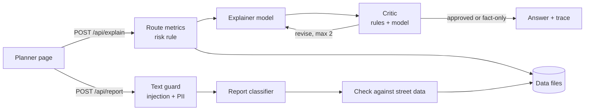

# Athena

Athena is a night-time journey planner for Sydney. For a trip between UNSW, the CBD and the inner west, it shows
the fastest route next to a lower-risk one, and explains the trade-off using only facts it can check. People can
also send anonymous reports about a street (for example, broken lights), and the app shows help locations near the
route.

Athena shows **risk indicators, not safety**. It never calls a route safe.


## Features

- **Trip planner** (`/`): options across walking, cycling and public transport, ranked five ways (balanced, lower
  risk, fastest, fewest changes, least walking). Each option is labelled lower, similar or higher risk than the
  fastest one, with the facts behind the label.
- **Explain this trade-off**: a language model writes 2-4 short claims about the fastest vs lower-risk route, each
  citing the facts it uses. Code rules and a second model check every claim. Unsupported claims are sent back for
  revision (at most twice); after that the app falls back to a plain fact-only explanation.
- **Street reports**: personal details are removed and injection attempts are blocked before any model sees the
  text. A classifier then decides whether to approve, review or reject the report, and an approved report adds a
  small, fading penalty to that street.
- **Street map** (`/map`) coloured by risk for a chosen time, and **help nearby** (police, hospital, station, 000)
  without any model call.

Every response includes a trace of the steps taken: which model answered, tokens, estimated cost and the prompt
version.

## How it works

Athena is a fixed workflow, not an open-ended agent. The planner calls two typed endpoints, `POST /api/explain`
and `POST /api/report`, and only three steps call a model (explainer, critic, report classifier), all through a
LiteLLM gateway.



**Risk score.** We use a rule, not a trained model, because there are no risk labels to learn from. Each street
gets a score per time of night from its path type, lighting, tunnels and nearby open venues. A route's score is
0.55 × the time-weighted average street score + 0.45 × its worst stretch. Unknown lighting is scored halfway
between lit and unlit and is always shown as unknown. Details: [docs/model_card.md](docs/model_card.md).

## Running it

You need Python 3.12 or 3.13 and git. No API key is needed: `SAMPLE_MODE=true` uses an offline stand-in for the
models, and the app says so on screen.

**macOS / Linux**

```bash
git clone --branch comp3110 https://github.com/shuruthy24/Athena.git && cd Athena
python3 -m venv .venv && source .venv/bin/activate
python -m pip install -r requirements-lock.txt
SAMPLE_MODE=true python -m uvicorn athena.server:app --port 8001
```

**Windows (PowerShell)**

```powershell
git clone --branch comp3110 https://github.com/shuruthy24/Athena.git; cd Athena
python -m venv .venv
.venv\Scripts\python -m pip install -r requirements-lock.txt
$env:SAMPLE_MODE="true"
.venv\Scripts\python -m uvicorn athena.server:app --port 8001
```

Then open http://localhost:8001 (planner) and http://localhost:8001/map (street map). Stop the server with Ctrl+C.

On a machine with a small home-directory quota (such as the UNSW lab machines), create the virtual environment in
`/tmp` instead: `python3 -m venv /tmp/$USER-athena && source /tmp/$USER-athena/bin/activate`. It is about 450 MB,
and `/tmp` is cleared between machines, so recreate it if it is missing.

To use the real models, copy `.env.example` to `.env`, add your gateway key and model names, and start the server
without `SAMPLE_MODE`. `python scripts/check_stack.py` checks the connection.

## Checking it works

In a second terminal (activate the virtual environment again first):

```bash
source .venv/bin/activate
python scripts/check.py
python scripts/verify_demo.py --base-url http://127.0.0.1:8001
```

`check.py` (also `make check`) runs the tests, regenerates every offline result and compares it with the
committed file, checks the frozen test sets, scans for secrets, validates the data, and runs every feature check.
`verify_demo.py --base-url` runs the feature checks against the server you started (three checks that need
access inside the app are skipped over HTTP; `check.py` runs them). On Windows, use
`.venv\Scripts\python` instead of `python`.

Don't run `verify_demo.py` without `--base-url`: that rewrites the committed `evals/results/verify.json`.

## Results

Generated from `evals/results/` (`make readme`); `make check` fails if this table is out of date. The full table,
with baselines, confidence intervals and what each result means, is in [docs/evaluation.md](docs/evaluation.md).

<!-- results:start -->
| What we measured | Result | File (evals/results/) |
| --- | --- | --- |
| Route choice on real data (126 trips) | lower-risk pick: risk score -1.7% for +0.4 min; lit share 27.0% vs 29.9% for the fastest | `route_baselines.json` |
| Explanations pass every fact check (live traces) | 36/36 | `assertions.json` |
| Critic rules catch planted errors | recall 1.00 on 276 synthetic claims | `offline.json` |
| LLM judge vs human labels | TPR 1.00, TNR n/a (no FAIL labels held out) | `judge_audit.json` |
| Blind A/B: LLM vs fact-only text | LLM 3, fact-only 3, tie 0 | `ab.json` |
| Injection guard on held-out probes | recall 0.21 (1.00 on the set it was tuned on) | `offline.json` |
| Injected reports admitted end to end (live) | 4/24 (keyword baseline 19/24) | `injection_e2e.json` |
| PII removed before any model | recall 1.00 on 17 spans (regression set) | `pii.json` |
| Report classifier, dev split | candidates can't be separated: dev has no reports that should be held | `classifier_dev.json` |
| Labeller agreement | kappa 0.40 (action), 0.65 (category), 49 reports | `label_agreement.json` |
| Data quality checks | 0 failures | `data_quality.json` |
| Feature checks | 17/17 pass | `verify.json` |
| Report classifier, test split | not run: held back on purpose | `classifier_test.json` |
| Load test | not run: not deployed | `ops.json` |
<!-- results:end -->

## Data

| Data | Source | Licence |
| --- | --- | --- |
| Streets, lighting, street lamps, night venues | OpenStreetMap snapshot, 15 Nov 2026 | ODbL 1.0 |
| Public transport timetable | TfNSW GTFS, 15 Nov 2026 | CC BY 4.0 |
| Trips (42 place pairs × 3 times × 3 modes) | precomputed with OpenTripPlanner from the two above | derived |
| Help locations | OpenStreetMap, 27 Oct 2026 | ODbL 1.0 |
| Street reports | written by the team and collected from others with consent | project |
| Hand-made sample routes | drawn by the team; used only as a fixed regression set | project |

`make data` rebuilds `data/processed/` from the raw snapshots, and `make data-verify` checks the rebuild matches.
Sources, cleaning steps, privacy and licences: [data_sources.md](data_sources.md).

## Project structure

```
athena/     the app: workflow, text guard, model client, classifiers, data access, web server
prompts/    versioned prompt files
pipeline/   data pipeline (ingest, clean, features, trips, checks) and report labelling tools
evals/      evaluation scripts, test sets, human labels, saved traces and results/
data/       processed data, the hand-made sample, labelled reports
scripts/    check.py, reproduce.py, verify_demo.py and report generators
docs/       evaluation, metrics, design, model card, status
tests/      pytest suite (uses a mock model gateway)
```

## Limitations

- The risk score is a rule we chose, not a measure of safety. On the real data it does not favour lit streets:
  the lower-risk pick has a slightly lower lit share than the fastest route.
- Lighting data is thin: most streets in OpenStreetMap have no lighting tag.
- OpenTripPlanner usually gives one walking route per trip, so most alternatives are public transport options.
- The text guard misses most held-out injection attempts, and some still get through with the live classifier.
- Our evaluation sets are small and mostly written by us, which makes the results look better than they would on
  real users.

What is unfinished, known issues and how the system differs from the demo: [docs/STATUS.md](docs/STATUS.md).
Readiness: [docs/design.md](docs/design.md). Team contributions: [CONTRIBUTIONS.md](CONTRIBUTIONS.md).
