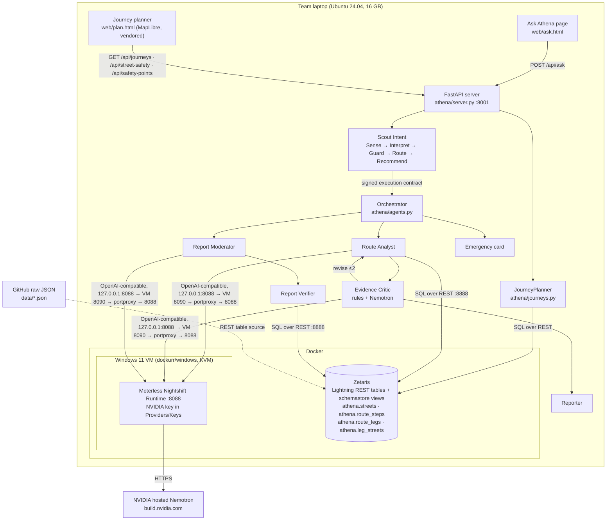

# 03 · Technical architecture

## System overview

## Request lifecycle (route question)
| # | Component | What happens | Model | Evidence in trace |
|---|---|---|---|---|
| 1 | Scout Sense | Stage 1: weighted trigger scan (word-stem regexes, under 16 ms, self-tested at startup). Stage 2: local TF-IDF similarity to the registry examples, plus a contextual term from the selected trip. Combined with the canonical weights 0.40/0.35/0.20/0.05 | none | `scout-intent` step, `scout.decision` event |
| 2 | Scout Interpret | Binds origin, destination, time band and mode from the text, falling back to the UI's trip. Validates against enums | none | parameters in the contract |
| 3 | Scout Guard | Injection patterns (instruction override, role drift, embedded control, Unicode bidi, tool references, risk tampering), RBAC, surface scope, PII redaction, rate limit | none | `risk` in the contract |
| 4 | Scout Route + Recommend | Capability graph to tool plan (Zetaris or sample, Nightshift or stub, critic rules), then model profile (Nemotron fast or critic). Signs an HMAC-SHA256 contract with a 5-minute TTL | none | `contract.issued` |
| 5 | Data | Each executor verifies the contract, then runs two SQL statements on Zetaris (validated values only) | none | `data` step, SQL shown in UI |
| 6 | Route metrics | Risk = 0.55 × distance-weighted mean + 0.45 × worst stretch; lit and unknown shares; approved-report penalty | none | `route-metrics` step |
| 7 | Route Analyst | Nemotron drafts 2–4 claims as JSON, each citing fact keys | Nemotron fast | `route-analyst` step + model |
| 8 | Evidence Critic | Deterministic rules plus a Nemotron critic. If either flags a claim, the draft goes back to the analyst (up to 2 revisions), then a fact-only fallback | Nemotron critic | `evidence-critic` step, verdict |
| 9 | Reporter | Builds the route cards, claims, confidence, SQL evidence and help numbers | none | response |

## Request lifecycle (journey planner)
| # | Component | What happens |
|---|---|---|
| 1 | `web/plan.html` | The user picks origin, destination, mode (transport, walk, cycle), departure band (6 pm, 10 pm, 1 am) and sort order. The choice is kept in the URL so a link reproduces the view |
| 2 | `GET /api/journeys` | `planner_source()` picks live OpenTripPlanner when `OTP_URL` is set and answers a ping; otherwise the precomputed alternatives in Zetaris (`athena.route_legs`, `athena.leg_streets`), or local JSON in sample mode. If live routing fails mid-request the server falls back to precomputed and sets `degraded` |
| 3 | `JourneyPlanner.plan` | Groups leg rows into itineraries, scores every walking or cycling leg on Zetaris street attributes with the same formula as the agent (0.55 × distance-weighted mean + 0.45 × worst stretch, plus approved-report penalties), labels each with the validated bands (lower < 0.33 ≤ moderate < 0.55 ≤ higher; more than 30% unknown lighting → "insufficient lighting data"), merges duplicate itineraries returned by both the fastest and the Athena search, then ranks |
| 4 | Ranking | `fastest`, `lower_risk`, `balanced` (duration and risk normalised across the candidates, weighted evenly), `fewest_transfers`, `least_walking`. Ranking only reorders what the router returned; it never creates a route |
| 5 | Map | Each leg's OTP encoded polyline is decoded in the browser and drawn as-is (no straight-line fakes). The selected route is drawn in line colours, the others dimmed; tapping a line or a card selects it. The street-risk overlay is the street geometry joined to the risk values Zetaris serves for that band. Help locations come from OpenStreetMap via `scripts/fetch_safety_points.py`, and each route lists those within 400 m |
| 6 | Hand-off | "Ask Athena about this route" opens `/ask` with the same trip and question, where the evidence-checked agent explains it |

The map starts on a plain background style and adds the OpenFreeMap basemap afterwards, so routes, risk overlay and
help markers still render when tiles are blocked or the laptop is offline. MapLibre is vendored under `web/vendor/`.

## Key engineering decisions
| Decision | Why | Trade-off |
|---|---|---|
| Implement Scout Intent in Python from the published spec | No Scout runtime package is published; the repo is a spec plus an eval harness | We own conformance. We followed the spec's numbers and documented each "implementer's choice" in code |
| Renormalise the score weights over available signals | With no conversation context, the canonical formula caps scores at 0.75, below the High band | Documented deviation; bands keep their meaning |
| Local TF-IDF for the Stage-2 semantic term | No extra model and no network call; under 1 ms | Weaker paraphrase handling than an embedding model |
| Deterministic critic **and** model critic | Rules catch numbers and wording with certainty; the model catches unsupported meaning | Two calls per draft. Bounded by `MAX_REVISIONS=2` and the fact-only fallback |
| Zetaris REST with login fallback | API tokens return "Not Allowed" on the local install | Needs the Zetaris login in `.env` |
| Data in Zetaris via REST tables over HTTP JSON | Zetaris can't read laptop files; this is the Setup Guide's own pattern | Depends on the Zetaris server reaching the URL; local HTTP fallback documented |
| Nightshift in a Windows VM | No Linux x86 build of Nightshift exists | About 4 GB of RAM; must open Nightshift after each VM start |
| Pre-computed route alternatives | Running OpenTripPlanner live needs about 10 GB of RAM, which doesn't fit alongside Zetaris and the VM | Two places only. `OTPSource` serves live routes through the same interface when `OTP_URL` is set; every response carries a `freshness` object so the UI never implies live routing it doesn't have |
| Journey safety computed on the server, not in the browser | One scoring implementation shared with the agent, so the planner and Ask Athena can't disagree | Each request re-reads street attributes (12 rows; negligible) |
| Emergency bypasses clarification and models | Speed and certainty matter more than nuance | Keyword-based; misses are covered by 000 always being visible in the header |

## Failure handling
| Failure | Behaviour |
|---|---|
| Zetaris unreachable or a query fails | Trace logs the failure, `scout.replan` issues a child contract that routes to sample data, and the answer says so |
| Live OTP unreachable or errors | Precomputed alternatives, with a `degraded` notice shown above the route cards |
| Basemap tiles blocked | Routes and overlays draw on a plain background; a note says the basemap is unavailable |
| Help locations not fetched | The toggle is disabled and the map key says so; route cards omit the "help near this route" list |
| Nightshift or model error on the draft | Fact-only explanation, confidence `low`, critic verdict `fallback-error` |
| Model critic error | Deterministic rules decide alone; noted in the trace |
| Critic rejects all drafts | Fact-only explanation, verdict `fallback` |
| Moderator error | Report goes to human review |
| Injection or policy breach | Blocked at the guard; no contract; nothing executes |
| Contract tampered, expired or out of scope | The executor raises `ContractError` and refuses |

## API
- `POST /api/ask` `{message (1–500 chars), trip?: {origin, destination, band, mode}, session?}` returns answer, intent,
  claims, routes, evidence SQL, confidence, help, scout decision, trace and events.
- `GET /api/health` returns versions, Scout self-test, and Zetaris and Nightshift reachability with the model list.
- `GET /api/places` lists the 7 places.
- `GET /api/journeys?origin=&destination=&band=18|22|01&mode=walk|bike|transit&sort=fastest|lower_risk|balanced|fewest_transfers|least_walking`
  returns journey options with legs, encoded polylines, per-leg and per-journey safety, explanations, `freshness`,
  `coverage` and the SQL evidence. Uncovered trips return `coverage: false` with a message.
- `GET /api/street-safety?band=` returns GeoJSON street geometry joined to the Zetaris risk values for the overlay.
- `GET /api/safety-points` returns OpenStreetMap help locations (police, hospitals, emergency phones, stations), or
  `available: false` until `scripts/fetch_safety_points.py` has been run.
- `GET /docs` serves OpenAPI. `/` is the journey planner, `/ask` is Ask Athena, `/map` is the pre-existing route map.

## Deployment
Local only, for judging and the demo: `./run.sh` (Python venv). Sample mode needs nothing else. The live mode
needs the Zetaris Docker stack and Nightshift running. Cloud hosting is future work. A hosted page can't reach a
laptop's Zetaris or Nightshift.
