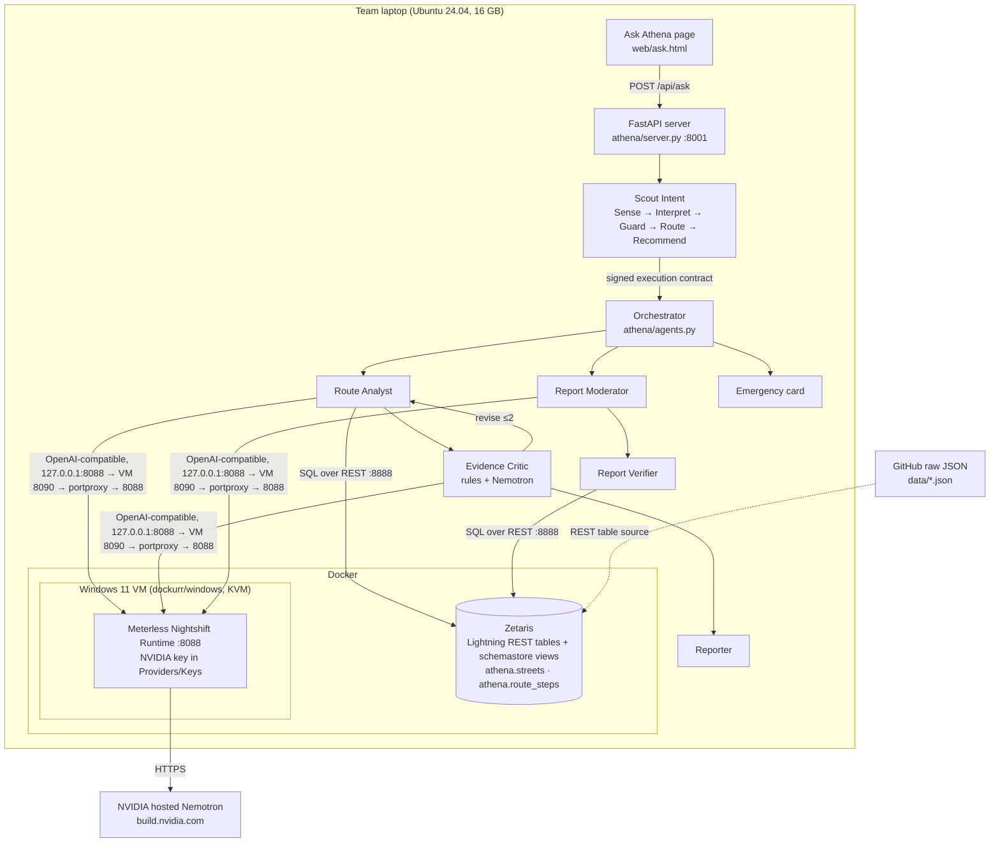

# 03 · Technical architecture

## System overview

## Request lifecycle (route question)
| # | Component | What happens | Model | Evidence in trace |
|---|---|---|---|---|
| 1 | Scout Sense | Stage 1: weighted trigger scan (word-stem regexes, under 16 ms, self-tested at startup). Stage 2: local TF-IDF similarity to the registry examples, plus a contextual term from the selected trip. Combined with the canonical weights 0.40/0.35/0.20/0.05 | none | `scout-intent` step, `scout.decision` event |
| 2 | Scout Interpret | Binds origin, destination, time band and mode from the text, falling back to the UI's trip. Validates against enums | none | parameters in the contract |
| 3 | Scout Guard | Injection patterns (instruction override, role drift, embedded control, Unicode bidi, tool references, risk tampering), RBAC, surface scope, PII redaction, rate limit | none | `risk` in the contract |
| 4 | Scout Route + Recommend | Capability graph to tool plan (Zetaris or sample, Nightshift or stub, critic rules), then model profile (Nemotron fast or critic). Signs an HMAC-SHA256 contract with a 5-minute TTL | none | `contract.issued` |
| 5 | Data | Each executor verifies the contract, then runs two SQL statements on Zetaris (validated values only) | none | `data` step, SQL shown in UI |
| 6 | Route metrics | Risk = 0.55 × distance-weighted mean + 0.45 × worst stretch; lit and unknown shares; approved-report penalty | none | `route-metrics` step |
| 7 | Route Analyst | Nemotron drafts 2–4 claims as JSON, each citing fact keys | Nemotron fast | `route-analyst` step + model |
| 8 | Evidence Critic | Deterministic rules plus a Nemotron critic. If either flags a claim, the draft goes back to the analyst (up to 2 revisions), then a fact-only fallback | Nemotron critic | `evidence-critic` step, verdict |
| 9 | Reporter | Builds the route cards, claims, confidence, SQL evidence and help numbers | none | response |

## Key engineering decisions
| Decision | Why | Trade-off |
|---|---|---|
| Implement Scout Intent in Python from the published spec | No Scout runtime package is published; the repo is a spec plus an eval harness | We own conformance. We followed the spec's numbers and documented each "implementer's choice" in code |
| Renormalise the score weights over available signals | With no conversation context, the canonical formula caps scores at 0.75, below the High band | Documented deviation; bands keep their meaning |
| Local TF-IDF for the Stage-2 semantic term | No extra model and no network call; under 1 ms | Weaker paraphrase handling than an embedding model |
| Deterministic critic **and** model critic | Rules catch numbers and wording with certainty; the model catches unsupported meaning | Two calls per draft. Bounded by `MAX_REVISIONS=2` and the fact-only fallback |
| Zetaris REST with login fallback | API tokens return "Not Allowed" on the local install | Needs the Zetaris login in `.env` |
| Data in Zetaris via REST tables over HTTP JSON | Zetaris can't read laptop files; this is the Setup Guide's own pattern | Depends on the Zetaris server reaching the URL; local HTTP fallback documented |
| Nightshift in a Windows VM | No Linux x86 build of Nightshift exists | About 4 GB of RAM; must open Nightshift after each VM start |
| Pre-computed route alternatives | Running OpenTripPlanner live needs about 10 GB of RAM, which doesn't fit alongside Zetaris and the VM | Two places only; live OTP is future work |
| Emergency bypasses clarification and models | Speed and certainty matter more than nuance | Keyword-based; misses are covered by 000 always being visible in the header |

## Failure handling
| Failure | Behaviour |
|---|---|
| Zetaris unreachable or a query fails | Trace logs the failure, `scout.replan` issues a child contract that routes to sample data, and the answer says so |
| Nightshift or model error on the draft | Fact-only explanation, confidence `low`, critic verdict `fallback-error` |
| Model critic error | Deterministic rules decide alone; noted in the trace |
| Critic rejects all drafts | Fact-only explanation, verdict `fallback` |
| Moderator error | Report goes to human review |
| Injection or policy breach | Blocked at the guard; no contract; nothing executes |
| Contract tampered, expired or out of scope | The executor raises `ContractError` and refuses |

## API
- `POST /api/ask` `{message (1–500 chars), trip?: {origin, destination, band, mode}, session?}` returns answer, intent,
  claims, routes, evidence SQL, confidence, help, scout decision, trace and events.
- `GET /api/health` returns versions, Scout self-test, and Zetaris and Nightshift reachability with the model list.
- `GET /docs` serves OpenAPI. `/` is Ask Athena; `/map` is the pre-existing route map.

## Deployment
Local only, for judging and the demo: `./run.sh` (Python venv). Sample mode needs nothing else. The live mode
needs the Zetaris Docker stack and Nightshift running. Cloud hosting is future work. A hosted page can't reach a
laptop's Zetaris or Nightshift.
